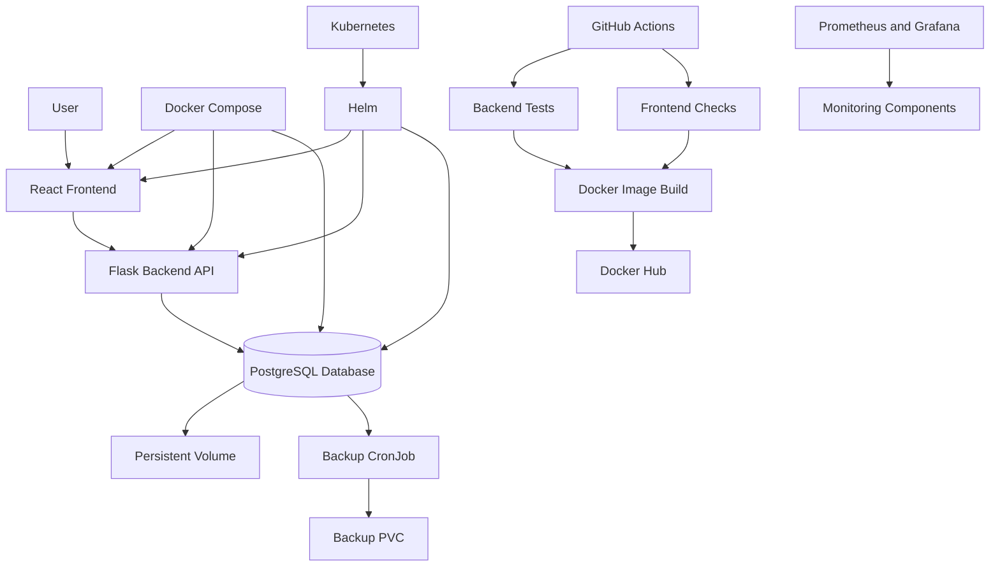

# PathPilot Cloud-Native Placement Tracker

A cloud-native placement tracking application built using React, Flask, PostgreSQL, Docker, Kubernetes, Helm, Terraform, and GitHub Actions.

## Overview

PathPilot is a placement tracking application designed to demonstrate practical DevOps and cloud-native engineering skills.

The project combines a full-stack application with containerization, Kubernetes orchestration, Helm-based deployments, persistent database storage, automated PostgreSQL backups, monitoring components, and a CI/CD pipeline.

## Technology Stack

| Category | Technologies |
|---|---|
| Frontend | React, Vite |
| Backend | Python, Flask |
| Database | PostgreSQL 17 |
| Containerization | Docker, Docker Compose |
| Orchestration | Kubernetes |
| Package Management | Helm |
| Infrastructure as Code | Terraform |
| Monitoring | Prometheus, Grafana, Alloy, Beyla |
| CI/CD | GitHub Actions |
| Container Registry | Docker Hub |
| Version Control | Git, GitHub |

## Architecture

## Key DevOps Implementations

### 1. Docker Containerization

- Containerized the React frontend and Flask backend.
- Configured PostgreSQL as a separate database service.
- Used Docker Compose to orchestrate multiple application services.
- Created Dockerfiles for building application images.
- Configured a production frontend image using Nginx.

### 2. Kubernetes Orchestration

- Deployed frontend and backend using Kubernetes Deployments.
- Deployed PostgreSQL using a StatefulSet.
- Configured Kubernetes Services for application and database communication.
- Used PersistentVolumeClaims for database storage.
- Stored database credentials in Kubernetes Secrets.
- Implemented startup, readiness, and liveness probes for backend health management.

### 3. Helm-Based Deployment

- Developed a reusable Helm chart for PathPilot.
- Used configurable Helm values for application deployment settings.
- Managed frontend, backend, and PostgreSQL Kubernetes resources through Helm templates.
- Deployed the Helm release in a dedicated `pathpilot-helm` namespace.
- Validated the chart using `helm lint` and `helm template`.

### 4. PostgreSQL Persistence

- Configured persistent storage for PostgreSQL using a PersistentVolumeClaim.
- Verified that database records survive PostgreSQL pod restarts.
- Maintained database storage separately from application pod lifecycles.

### 5. Automated PostgreSQL Backups

- Created a Kubernetes CronJob for scheduled PostgreSQL backups.
- Configured daily backups at 2:00 AM IST.
- Used PostgreSQL custom-format backups through `pg_dump`.
- Stored backup files on a dedicated 1 GiB PersistentVolumeClaim.
- Configured a seven-day backup retention policy.
- Tested scheduled and manually triggered backup Jobs.
- Validated backup archive contents using `pg_restore -l`.
- Tested database restoration into a separate temporary database.

### 6. Application Reliability and Health Checks

- Implemented backend health and readiness endpoints.
- Added database connection retry logic during backend startup.
- Configured Kubernetes startup, readiness, and liveness probes.
- Used
